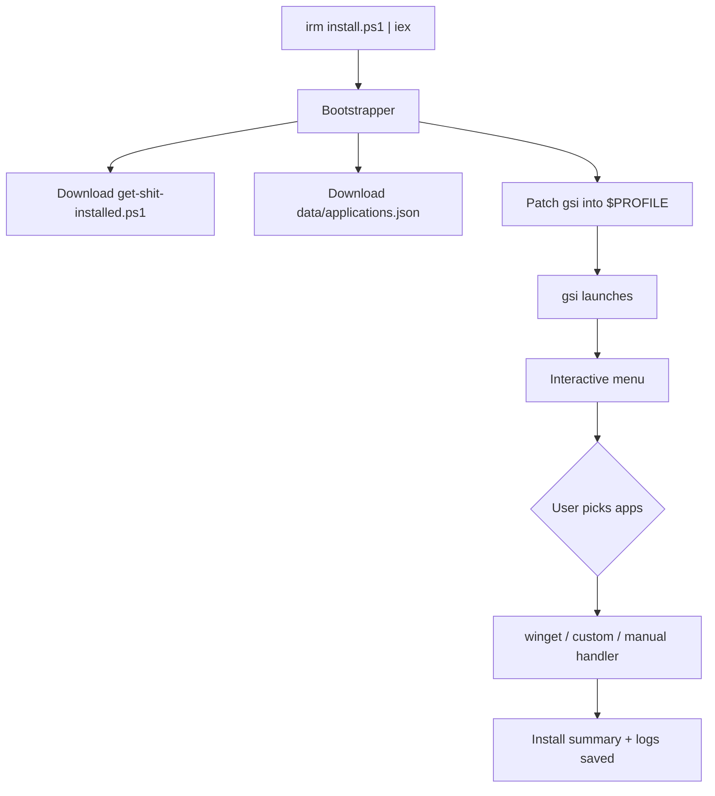

<div align="center">

# Get Shit Installed

### One command. Every app you need on Windows.

A terminal-based Windows software installer powered by **WinGet** and a simple **JSON catalog** — browse, select and install apps with a fully keyboard-driven interactive menu.


</div>

---

##  Why this exists

Setting up a new Windows PC means browser-hopping through a dozen download pages, clicking through installers and hoping you got the right version.

**GSInstalled** replaces all of that with a single command. Run it on a brand-new machine, pick what you want from the menu, press Enter — done.

---

##  Quick start

### PowerShell

```powershell
irm https://raw.githubusercontent.com/iabhnv19/GSInstalled/main/install.ps1 | iex
```

### Command Prompt (cmd)

```bat
powershell -NoProfile -ExecutionPolicy Bypass -Command "irm 'https://raw.githubusercontent.com/iabhnv19/GSInstalled/main/install.ps1' | iex"
```

That's it. The installer downloads everything, registers the `gsi` command and launches the menu immediately.

> If you get stale results right after an update to this repo, add a cache-buster: `...install.ps1?v=2`

---

##  What it does

| # | Step | Details |
|:-:|------|---------|
| 1 | **Download** | Fetches `get-shit-installed.ps1` and `data/applications.json` to `~\.get-shit-installed\` |
| 2 | **Register** | Adds a `gsi` function to your PowerShell profile so the command is always available |
| 3 | **Launch** | Opens the interactive menu right away — no need to open a new terminal first |

Everything is **idempotent**: running the installer again updates the files and re-patches the profile block without duplicating it.

### Highlights

-  Fully keyboard-driven interactive menu (arrows, Space, Enter, Esc, A, N)
-  Multi-column app list (up to 4 columns) with page support for large catalogs
-  Smooth incremental rendering — only changed rows repaint, no full-screen flicker
-  **Find / remove old versions** — scans registry for duplicate installs and offers cleanup
-  Extend the catalog by editing a single JSON file — no script changes needed
-  Works in PowerShell 5.1, PowerShell 7 and the VS Code terminal

---

##  Usage

After installing, open any PowerShell window and run:

```text
gsi
```

You'll see the interactive menu. Navigate with the keyboard, pick your apps, confirm and install.

### Command-line flags

```powershell
gsi          # Open the interactive menu
gsi -List    # Print all catalog entries
gsi -Update  # Re-run installs / check for updates
gsi -Search Python   # Filter catalog by name
```

---

##  Keyboard navigation

| Key | Action |
|-----|--------|
| ↑ / ↓ | Move up / down (within a column) |
| ← / → | Jump between columns |
| Space | Toggle selection |
| Enter | Confirm selection |
| Esc | Go back / exit |
| A | Select all |
| N | Clear selection |
| PageUp / PageDown | Switch pages |
| Home / End | First / last app |

---

##  Catalog

Apps live in [`data/applications.json`](data/applications.json). Three entry types are supported:

| Type | Behaviour |
|------|-----------|
| `winget` | Installed via `winget install --id <id> --exact` |
| `custom` | Handled by a reviewed custom action inside the script |
| `manual` | Displays instructions / source URL — nothing is executed |

**To add an app**, find its WinGet ID and add an entry:

```json
{
  "name": "My App",
  "category": "Utilities",
  "type": "winget",
  "id": "Publisher.AppName",
  "description": "Does something useful"
}
```

Verify package IDs with:

```powershell
winget search "app name"
winget show --id Publisher.AppName --exact
```

---

##  How it works



---

##  Important notes

- **GCC / G++** — the catalog installs **MSYS2** only. After it finishes, open the MSYS2 UCRT64 terminal and run:
  `pacman -S --needed mingw-w64-ucrt-x86_64-gcc`
- **WSL2** may require administrator privileges, virtualisation support and a restart.
- **Docker Desktop** requires WSL2 or a supported Hyper-V configuration.
- **JupyterLab** is a manual entry — install it with: `py -m pip install jupyterlab`
- **TLauncher** is a manual entry. Review third-party software carefully before installing.
- The installer does **not** bypass UAC or silently elevate itself.

---

##  Old-version cleanup

The menu includes **Find / remove old application versions**. It scans Windows uninstall registry records for duplicate names with different versions, keeps the newest and offers the rest for review.

- MSI packages with a recognized product GUID can be removed via `msiexec` after explicit typed confirmation.
- EXE / vendor-specific uninstallers are **not** run automatically — remove those through *Windows Settings → Apps → Installed apps*.
- Detection is heuristic. Side-by-side installs may be intentional. Review every candidate before removal.

---

##  Logs

Runtime logs are saved to `~\.get-shit-installed\logs\`. Installation summaries are appended to `logs\history.csv`.

---

##  Troubleshooting

<details>
<summary><b><code>gsi</code> is not recognized</b></summary>

- Open a **new** terminal. Terminals opened before the install don't see the updated profile.
- Check that `~\.get-shit-installed\get-shit-installed.ps1` exists.
- If it's missing, run the install command again.
</details>

<details>
<summary><b>"running scripts is disabled on this system"</b></summary>

Run this once to allow local scripts:

```powershell
Set-ExecutionPolicy RemoteSigned -Scope CurrentUser
```

Then open a new terminal and try `gsi` again.
</details>

<details>
<summary><b><code>winget</code> is not found</b></summary>

Install or update **App Installer** from the Microsoft Store, then run `gsi` again.
</details>

<details>
<summary><b>A WinGet install fails</b></summary>

- Check your internet connection.
- Run `gsi -Update` to retry. Package downloads can fail on a bad connection and a second run picks up where the first stopped.
- Verify the package ID is still valid: `winget search "app name"`.
</details>

<details>
<summary><b>Download fails with a TLS / SSL error</b></summary>

Add `[Net.ServicePointManager]::SecurityProtocol = [Net.SecurityProtocolType]::Tls12` before the `irm` command, or use the cmd one-liner from [Quick start](#-quick-start).
</details>

---

##  FAQ

**Is this safe to run?**
It's open source — read every line before running. See the scripts in this repo.

**Does it work offline?**
No. WinGet downloads packages from the internet.

**Can I run it more than once?**
Yes. Already-installed apps are detected and skipped by WinGet. The `-Update` flag re-checks everything.

**Does it work on Windows 7 / 8?**
No. It targets Windows 10 and 11 and relies on `winget`.

**How do I add my own apps?**
Edit `~\.get-shit-installed\data\applications.json` or open a PR against this repo.

---

##  Uninstall

Remove the downloaded files:

```powershell
Remove-Item "$HOME\.get-shit-installed" -Recurse -Force
```

Then remove the `gsi` block from your PowerShell profile (`notepad $PROFILE`) — it's clearly marked:

```powershell
# >>> GSInstalled >>>
...
# <<< GSInstalled <<<
```

---

##  Repository structure

```text
GSInstalled/
├── install.ps1              # Bootstrapper: registers gsi and launches the menu
├── get-shit-installed.ps1   # Main installer script
├── softup.ps1               # Convenience launcher (local use)
├── data/
│   └── applications.json    # App catalog
├── README.md                # You are here
├── LICENSE                  # MIT License
└── .gitignore
```

---

##  Security

This project downloads and runs PowerShell code from GitHub — **read the scripts before you run them**.

It makes these changes:

- Downloads files to `~\.get-shit-installed\`
- Adds a `gsi` function block to your PowerShell profile (`$PROFILE`)
- Installs apps through `winget` (no arbitrary URL execution from the catalog)
- May remove old application versions from the registry — only after your explicit typed confirmation

---

##  License & author

Released under the [MIT License](LICENSE).

## Developer

Developed by

<div align="center">

<table>
  <tr>
    <td align="center">
      <a href="https://github.com/iabhnv19">
        
        <br />
        <strong>Abhinav</strong>
        <br />
        @iabhnv19
      </a>
    </td>
  </tr>
</table>

</div>

<div align="center">

**Made with ❤️ and PowerShell.**

⭐ If this saved you time, consider starring the repo!

*Every app you need, one menu at a time.*

</div>
